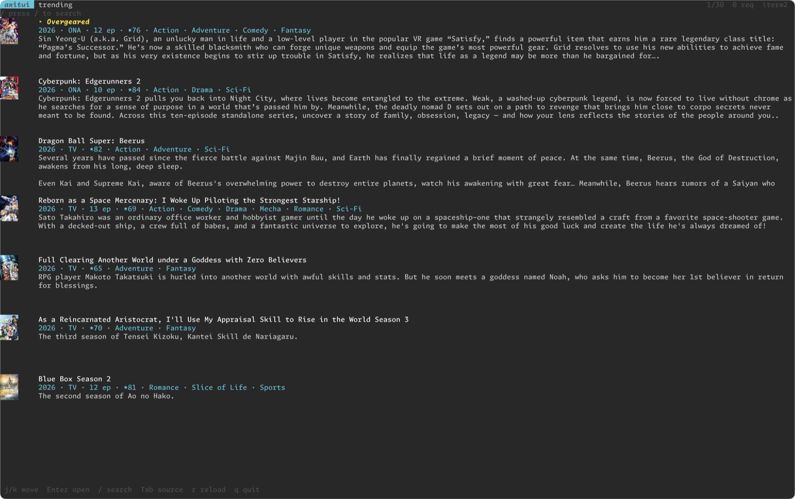
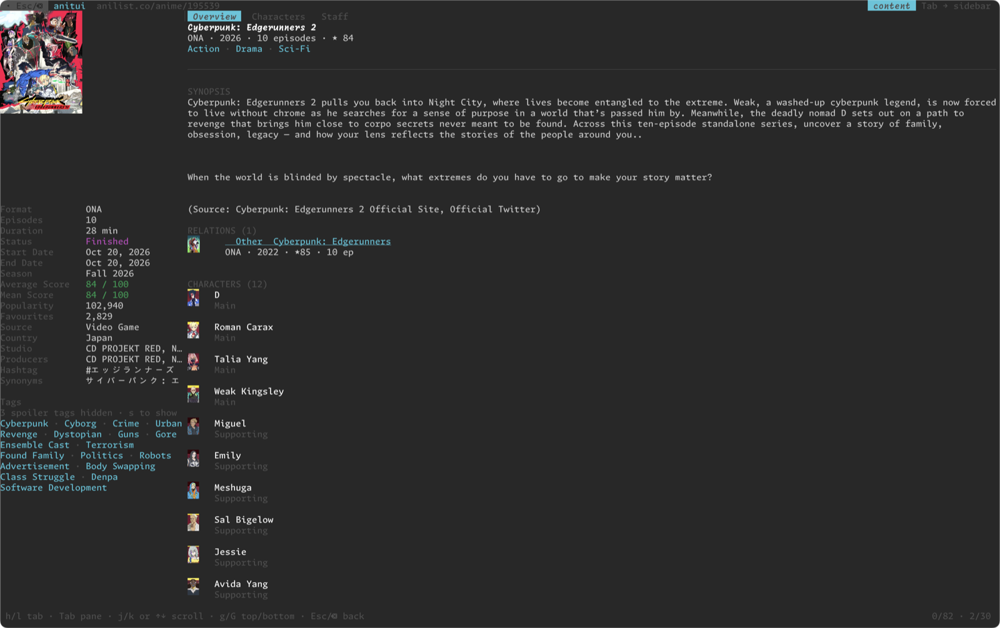

# aniscrobble

AniList progress tracker and terminal catalog browser.

- `login`, `sync`, `scrobble`: keep episode progress locally and push it to
  AniList. Safe to run offline: local progress is written first, the network
  step is resumable.
- `tui` (feature `tui`): read-only terminal UI to explore the AniList catalog.
  Trending, search, full media pages, staff/character pages and real cover art
  through the terminal image protocol.

The interesting part of the TUI is not the feature set, it is the execution
model: the UI never waits for the network. Every request is scoped to the widget
that asked for it, and a scope is cancelled the moment that widget changes or
goes away. See [`ARCHITECTURE.md`](ARCHITECTURE.md).

## Requirements

- Rust 1.88+ (edition 2024)
- For the TUI: a terminal with Kitty, Sixel or iTerm2 graphics for real cover
  images. Detection happens at startup with a terminal query. Without a
  graphics protocol the app falls back to Unicode half-blocks: still usable,
  coarser.

## Build

```sh
cargo build                        # CLI + TUI (default)
cargo build --no-default-features # CLI only
cargo build --release
```

The `tui` feature is on by default and pulls `crossterm`, `ratatui`,
`ratatui-image`, `reqwest` and `tokio`. Use `--no-default-features` (plus
`--features native-tls,vendored,brotli` as needed) for a CLI-only build without
those dependencies.

## CLI

```sh
aniscrobble login                  # open the AniList token page and store the token
aniscrobble scrobble 21 5          # record episode 5, then sync
aniscrobble scrobble --local-only 21 5   # record only, no network
aniscrobble scrobble -b 21 5       # record, then sync in a detached process
aniscrobble sync                   # push every pending episode
```

`scrobble` never lowers progress. An episode already at or below the stored
value is ignored. Pending entries stay queued until AniList accepts them, so an
interrupted sync is retried by the next one.

Data lives in the platform cache directory (`aniscrobble/data.db`, LMDB).

## TUI

```sh
cargo run -- tui
cargo run --release -- tui
```

The feature is on by default, so a bare `aniscrobble` also opens the TUI. With
`--no-default-features` the subcommand does not exist and a command is required.

### Screenshots

Trending list:



Media page, with cover, metadata, tags, relations and character thumbnails:



### Keys

| Key | Action |
| --- | --- |
| `j` / `k` / `↓` / `↑` | Move selection |
| `g` / `G` | First / last loaded item |
| `Enter` | List: open the media page. Media page: follow the focused link (media, genre, tag, staff) |
| `/` | Focus search input |
| `Tab` | List: toggle trending / search results. Media page: switch sidebar/content |
| `r` | Reload current view |
| `Backspace` | List: return to the media page a genre/tag was opened from |
| `Esc` | Leave search input, close the media page |
| `q` / `Ctrl-C` | Quit |
| Left click | List: open the clicked row. Media page: open the clicked relation or recommendation |
| `h` / `l` or `←` / `→` | Media page: switch tab (Overview / Characters / Staff) |
| `1` / `2` / `3` | Media page: jump to Overview / Characters / Staff |
| `n` / `p` | Media page: next / previous link (overview only) |
| `s` | Media page: show / hide spoiler tags |
| Wheel | List: move the selection (scrolls the view). Media page: scroll the focused column |

The media page loads relations, recommendations, characters and staff with a
second request, scoped to the page itself: closing it cancels whatever is still
in flight. Each related entry shows a thumbnail and is clickable: a left click
opens that media's page (the record is refetched in full) and remembers where
you came from. `Esc`/`Backspace` walk back one page at a time, then return to
the list. The bottom bar shows how many pages are behind the current one.

The list is an infinite scroll: moving near the last loaded row fetches the next
page and appends it to the same scope. There is no page counter and no page
keys; `g`/`G` jump to the first/last loaded item.

Character and staff rows (overview and their tabs) are links: click one, or
focus it with `n`/`p` and press `Enter`, to open that person's page. It shows
portrait, profile and description on the left, and the filmography on the right
— anime staff positions and voice acting roles for staff, the anime roles for
characters — paginated as you scroll. Every collaboration has a thumbnail and is
a link: click it, or focus it with `n`/`p` and press `Enter`, to open that anime.
`Esc`/`Backspace` returns to the media page you came from.

The content column has three tabs: **Overview** (genres, synopsis, relations,
the first 12 characters and staff, then recommendations), **Characters** and
**Staff**. The last two list everyone, 25 per page, and load the next page as
you scroll to the end. They show how many rows are loaded
(`CHARACTERS · 25 loaded`) but no total: AniList's totals for these lists are
unreliable. `h`/`l`, the arrow keys or `1`/`2`/`3` switch tabs, and the tab
labels are clickable too; switching resets that column's scroll.

The media page is split in two columns with independent scroll: the **sidebar**
(cover, every field, tags) and the **content** (title, genres, synopsis,
relations, recommendations, characters, staff). `Tab` switches the focus, the
top bar shows which column is active, and `↑`/`↓`, `k`/`j`, `g`/`G` and the
wheel scroll only that column. The cover scrolls with the sidebar. `n`/`p` move
a keyboard cursor over the relations and recommendations (highlighted,
auto-scrolled into view) and scrolling is always free: `j`/`k`, `g`/`G` and the
wheel move the view even with a link focused. The view follows the cursor only
when the cursor moves (`n`/`p`); if you scroll the link out of sight it stays
selected but `Enter` does nothing until you bring it back. `Enter` follows the
focused one: a relation/recommendation opens its page, a genre or tag leaves the
page and browses that filter. Links exist on the Overview tab only. That jump is
reversible: `Backspace` in the list returns to the page you came from, with its
own history still behind it. Without a focused link `Enter` does nothing.
Genres (content) and tags (sidebar) are clickable too, with the same effect.
`Tab` is what moves the focus between the two columns, so `n`/`p` walk the links
of the focused column only. Spoiler tags are hidden by default: `s` toggles
them, and when shown they are red. `Esc`/`Backspace` walks back one page, then
returns to the list.

### Configuration

| Variable | Values | Effect |
| --- | --- | --- |
| `ANISCROBBLE_TUI_PROTOCOL` | `halfblocks`, `sixel`, `kitty`, `iterm2` | Force an image protocol instead of querying the terminal. Useful on tmux/screen where the query fails. |

## Documents

- [`ARCHITECTURE.md`](ARCHITECTURE.md) - CLI storage/sync, TUI event loop and
  scope/cancellation model, module map.
- [`docs/roadmap.md`](docs/roadmap.md) - milestones and acceptance criteria.
- [`docs/anilist-api.md`](docs/anilist-api.md) - API notes: endpoint, queries,
  limits.
- [`AGENTS.md`](AGENTS.md) - working rules for humans and coding agents.

## Status

CLI: login, local progress and sync are usable. TUI: PoC, no login, no list
mutations, no persistence of the catalog. See the roadmap.
